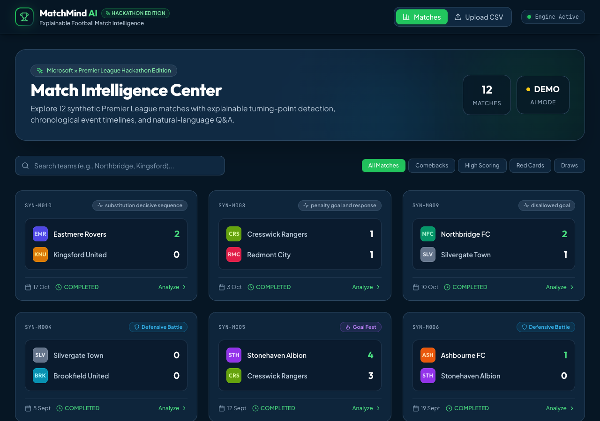
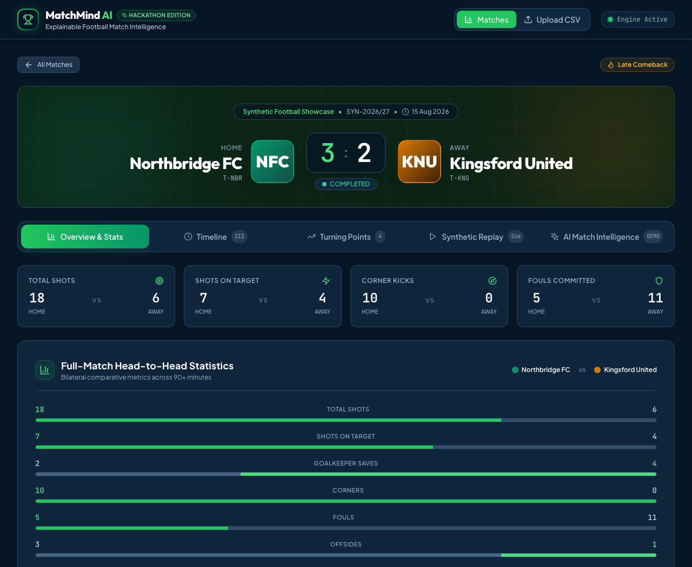
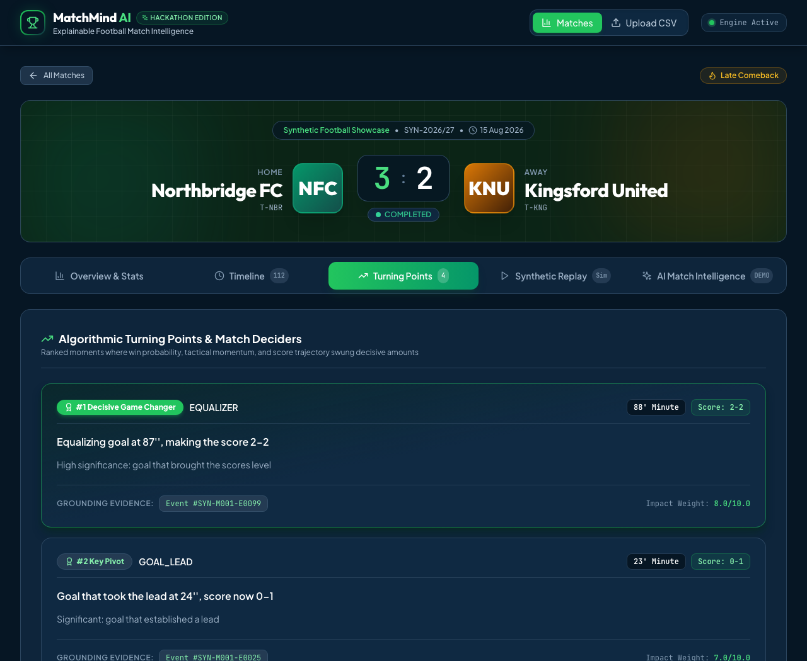
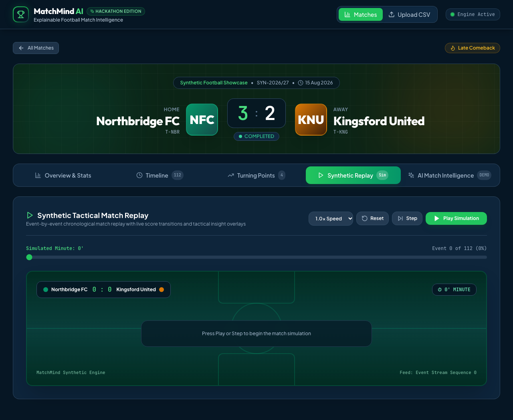
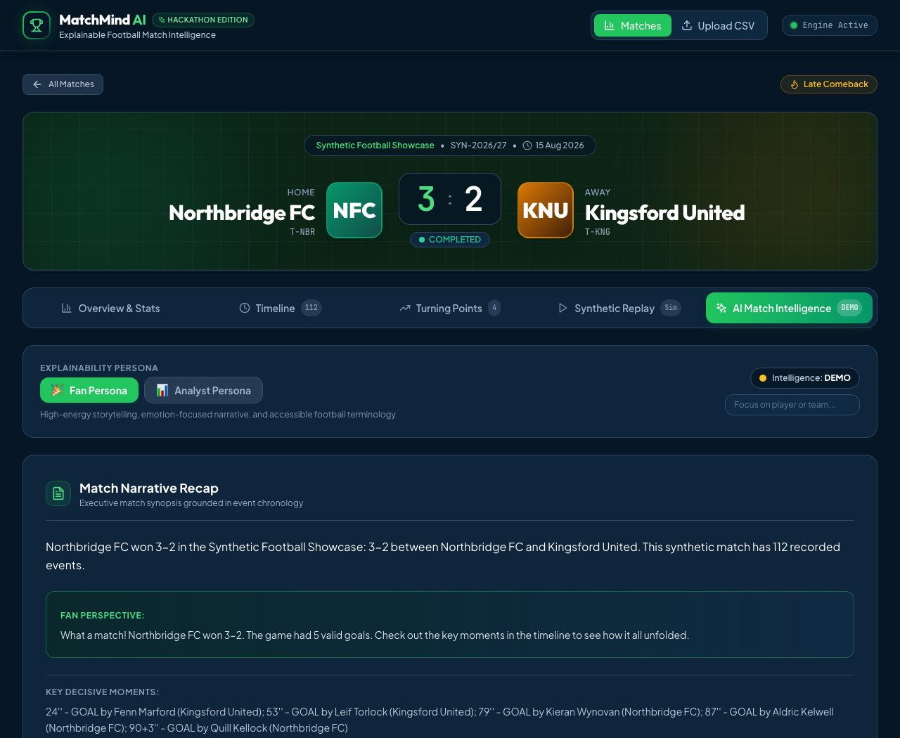
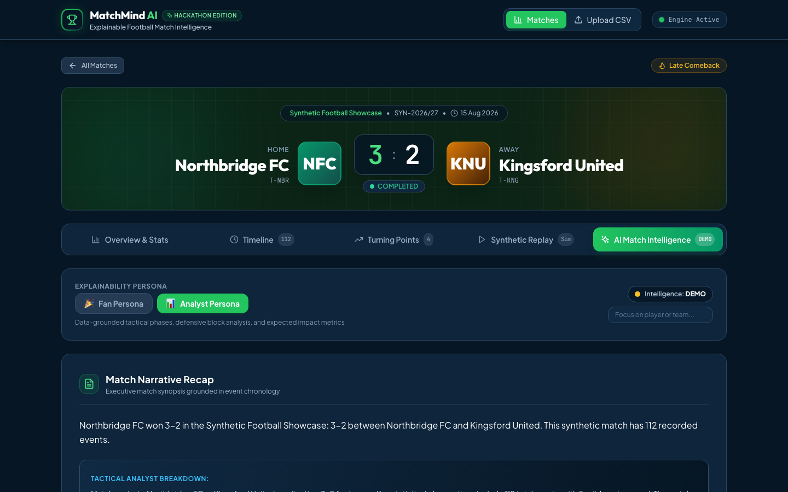
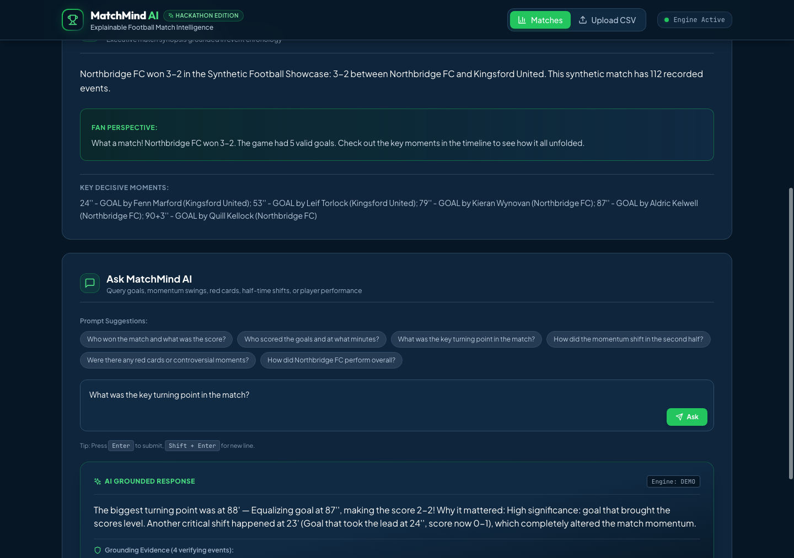
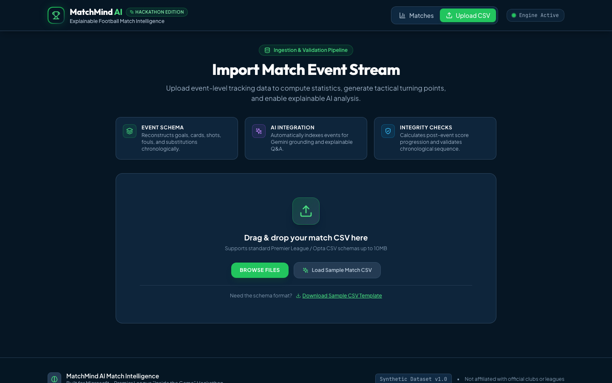
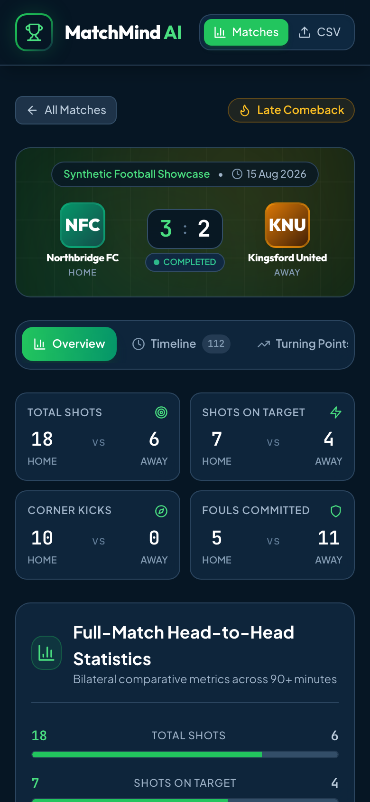
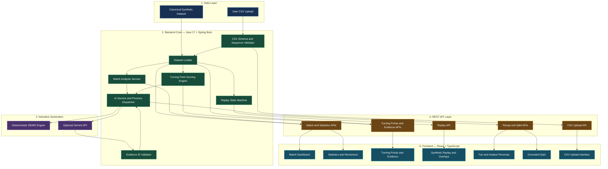

# MatchMind AI — Explainable Football Match Intelligence

> **One Moment. The Evidence. The Story.**  
> Transforming synthetic football events into explainable match intelligence, ranked pivotal moments, adaptive Fan/Analyst narratives, and synchronized broadcast-style replay overlays.

[](https://www.oracle.com/java/)
[](https://spring.io/projects/spring-boot)
[](https://react.dev/)
[](https://www.typescriptlang.org/)
[](https://vitejs.dev/)
[](https://tailwindcss.com/)
[](backend/src/test/)
[](dataset/)

---

## 1. Project Overview & Pitch

Football stories do not start and end with the final scoreline. A 3–2 result or a goalless draw hides the tactical shifts, disciplinary crises, momentum swings, and individual contributions that decided the match. Traditional match statistics (possession percentages, basic shot tallies) summarize volume but fail to explain **why** key moments mattered. Meanwhile, unconstrained Large Language Models hallucinate speculative narratives disconnected from underlying facts.

**MatchMind AI** bridges this gap. Built for the **Microsoft × Premier League "Inside the Game" Hackathon**, MatchMind AI is an evidence-first match intelligence platform. It ingests discrete, football-realistic synthetic match events, reconstructs deterministic match states, algorithmically scores and ranks pivotal turning points, and grounds personalized natural-language narratives and on-screen broadcast replay overlays in auditable event records.

### Quick Links

- **Public Frontend (Vercel):** [https://match-mind-ai-explainable-football.vercel.app/](https://match-mind-ai-explainable-football.vercel.app/)
- **Public Backend (Render):** [https://matchmind-ai-explainable-football-6kp4.onrender.com](https://matchmind-ai-explainable-football-6kp4.onrender.com/)
- **GitHub Repository:** [https://github.com/aryangaikwad-966/MatchMind-AI-Explainable-Football-Match-Intelligence](https://github.com/aryangaikwad-966/MatchMind-AI-Explainable-Football-Match-Intelligence)
- **Official Hackathon Source:** [Microsoft × Premier League Hackathon Rules](https://github.com/microsoft/insidethegamehackathon/blob/main/OFFICIAL%20RULES.md)

---

## 2. Live Demo & Judge Access Guide

The project is deployed across two independent cloud environments:

| Tier | Service | URL | Notes |
|---|---|---|---|
| **Frontend** | Vercel Static Web Hosting | [`https://match-mind-ai-explainable-football.vercel.app/`](https://match-mind-ai-explainable-football.vercel.app/) | Single-page React application with client-side routing and instant-connect fallback |
| **Backend** | Render Cloud Web Service | [`https://matchmind-ai-explainable-football-6kp4.onrender.com`](https://matchmind-ai-explainable-football-6kp4.onrender.com/) | Spring Boot container exposing REST APIs at `/api/*` |

> [!NOTE]  
> **Free-Tier Cloud Instance Wake-up Notice:**  
> Render's free tier spins down idle backend web services after inactivity. If the service is in a cold state, the initial HTTP request may take 50–90 seconds to provision the container and start the JVM. If the frontend displays a connection prompt, you can input your active backend URL directly into the provided connect bar or test locally with zero configuration using the included DEMO engine.

### Judge Evaluation Walkthrough (What to Try First)

1. **Explore the Match Dashboard:** View all 12 bundled synthetic matches with scenario badges (`Late Comeback`, `Red Card Turning Point`, `Goal Fest`, `Defensive Battle`).
2. **Inspect Match Analysis (`SYN-M001` — Northbridge FC 3–2 Kingsford United):**
   - Click **Analyze** to open the match console.
   - In the **Overview & Stats** tab, observe bilateral head-to-head metrics (shots, shots on target, saves, fouls, corners) and the **1st Half vs. 2nd Half Momentum Dynamics** card.
3. **Audit Algorithmic Turning Points:**
   - Switch to the **Turning Points** tab.
   - Examine ranked decisive moments. Notice that each turning point displays a significance score (e.g. `8.0/10.0` for the 88' Equalizer), tactical rationale, score trajectory, and clickable **Grounding Evidence** (`#SYN-M001-E0099`).
4. **Experience the Evidence-to-Overlay Synthetic Replay:**
   - Open the **Synthetic Replay** tab.
   - Click **Play Simulation** or step through chronologically. As the simulated clock advances, watch the match score reconstruct from valid events and live tactical overlay cards pop up on the pitch.
5. **Evaluate Dual Audience Personalization & Q&A:**
   - Open the **AI Match Intelligence** tab.
   - Toggle between **Fan Persona** (emotional, narrative storytelling) and **Analyst Persona** (data-grounded tactical phases and conversion metrics).
   - In the **Ask MatchMind AI** console, test sample prompts like:
     - *"What was the key turning point in the match?"*
     - *"Who scored the goals in this match?"*
     - *"Were there any red cards or controversial moments?"*
     - Input `"Kingsford United"` in the preference filter to see club-focused personalization.
6. **Test the CSV Ingestion Pipeline:**
   - Navigate to **Upload CSV** in the top navigation.
   - Inspect the automated schema, sequence, and score validation checks, download the sample template, or drop an event stream to test custom match ingestion.

---

## 3. Problem & Solution

```
                               THE FOOTBALL INTELLIGENCE GAP
   RAW EVENT LOGS                                                 UNVERIFIED AI PROSE
   1,200+ raw CSV rows                                            Hallucinated match facts,
   Timestamped passes & fouls     ═══════════════════════════►    unverifiable claims,
   No tactical context                                            generic sports clichés
                                        │
                                        ▼
                           MATCHMIND AI HYBRID ENGINE
   ┌─────────────────────────────────────────────────────────────────────────────────┐
   │ 1. Deterministic State Reconstruction (Goals, chronology, score monotonicity)    │
   │ 2. Algorithmic Turning-Point Scoring (Red cards: 9.0, Equalizers: 8.0, etc.)    │
   │ 3. Tool-Grounded LLM Orchestration (Gemini queried via backend function tools)   │
   │ 4. Verifiable Event Evidence Attribution (Every claim cites exact event_id)      │
   │ 5. Dual Audience Personas (Fan vs. Analyst) + Broadcast-Style Replay Overlays   │
   └─────────────────────────────────────────────────────────────────────────────────┘
```

- **The Problem:** Broadcasters, journalists, and fans are inundated with event data. Traditional graphics show static totals (e.g., 14 shots vs 6), but miss the critical narrative inflection point. Meanwhile, generative AI solutions often produce plausible-sounding hallucinations—inventing goals, misattributing scorers, or speculating on player motives without evidence.
- **The Solution:** MatchMind AI decouples **fact-finding** from **storytelling**. Deterministic Java services reconstruct the true match progression, validate score consistency, and compute mathematical turning points. When generative narrative is requested, the AI provider (Gemini) is restricted to structured function calls executed against authoritative match state, and all returned evidence IDs are cryptographically validated against source event logs.

---

## 4. Key Features

| Feature | Description | Placement | Engine Type |
|---|---|---|---|
| **Deterministic Match Reconstruction** | Calculates exact full-match statistics (shots, on-target %, saves, corners, fouls, cards, substitutions) strictly from event logs. | `Overview & Stats` Tab | Deterministic Java Service |
| **Half-by-Half Momentum Dynamics** | Breaks down match trajectory into 1st Half vs 2nd Half deltas, revealing halftime tactical adjustments. | `Overview & Stats` Tab | Deterministic Java Service |
| **Ranked Turning-Point Detection** | Algorithmic scoring engine that ranks game-deciding moments (Equalizers, lead goals, red cards, penalties, disallowed goals) with impact weights. | `Turning Points` Tab | Deterministic Weighted Model |
| **Evidence-to-Overlay Replay** | Simulated broadcast replay featuring play/pause/step controls, dynamic pitch telemetry, clock progression, and synchronized insight overlays. | `Synthetic Replay` Tab | Dynamic State Machine |
| **Dual Persona Narratives** | Dynamic recap generation providing distinct perspectives: high-energy emotion for **Fans** and tactical phase breakdown for **Analysts**. | `AI Match Intelligence` Tab | Hybrid (Deterministic / Gemini) |
| **Contextual Q&A Assistant** | Natural-language query interface answering match inquiries with explicit citations of verifying event IDs. | `AI Match Intelligence` Tab | Hybrid (Function-Calling / Fallback) |
| **Preference-Based Personalization** | Personalizes recaps and answers around a specific club or player without distorting underlying match facts. | `AI Match Intelligence` Tab | Rule-Guided Context Injection |
| **Robust CSV Ingestion Validator** | Drag-and-drop CSV importer that enforces schema conformity, contiguous sequences, monotonic chronology, and scoring semantics. | `/upload` Route | Apache Commons CSV + Spring MVC |

---

## 5. What Makes It Different: Evidence-to-Overlay

Many hackathon prototypes rely on static dashboards or ungrounded chatbot widgets. MatchMind AI introduces **Evidence-to-Overlay** synchronization:

1. **State Machine Progression:** The synthetic replay simulates the chronological event stream sequence $0 \to N$.
2. **Dynamic In-Memory Score Reconstruction:** Scores update only when an authorized scoring event (`GOAL`, `OWN_GOAL`, `PENALTY_SCORED` with `is_disallowed=false`) occurs.
3. **Synchronized Insight Triggering:** When an event coincides with an identified turning point, the engine generates an overlay payload containing the simulated minute, score state, insight type, tactical rationale, and the underlying evidence ID.
4. **Broadcast Readiness:** The resulting JSON contract (`ReplayState`) provides the exact timing, position, and textual payload needed by broadcast graphics systems (e.g., Vizrt, Unreal Engine) to render synchronized lower-thirds or pitch overlays during live or recorded coverage.

---

## 6. Official Hackathon Challenge Alignment

### Five-Stage Pipeline Mapping

| Pipeline Stage | Official Hackathon Requirement (Section 4.1) | Actual Implementation in Codebase | Supporting Files / APIs | Status |
|---|---|---|---|---|
| **1. Ingest** | Ingest synthetic match events as they happen (passes, shots, tackles, possession, cards, metadata). | Bundled CSV dataset loader + multi-part CSV upload controller enforcing sequence, timestamp, and score monotonicity. | [`DatasetLoader.java`](file:///Users/aryangaikwad/Desktop/MatchMind%20AI%20%E2%80%94%20Explainable%20Football%20Match%20Intelligence./backend/src/main/java/com/matchmind/backend/service/DatasetLoader.java), [`UploadController.java`](file:///Users/aryangaikwad/Desktop/MatchMind%20AI%20%E2%80%94%20Explainable%20Football%20Match%20Intelligence./backend/src/main/java/com/matchmind/backend/controller/UploadController.java), `POST /api/matches/upload` | **Implemented & Verified** |
| **2. Interpret** | Convert events into meaningful football statistics, patterns, and contextual states. | Computes bilateral statistics (shots, on-target %, saves, corners, fouls, offsides, discipline) and 1st/2nd half comparison deltas. | [`MatchAnalysisService.java`](file:///Users/aryangaikwad/Desktop/MatchMind%20AI%20%E2%80%94%20Explainable%20Football%20Match%20Intelligence./backend/src/main/java/com/matchmind/backend/analysis/MatchAnalysisService.java), `GET /api/matches/{id}/statistics`, `GET /api/matches/{id}/comparison` | **Implemented & Verified** |
| **3. Explain** | Explain why key moments matter using evidence rather than unsupported narratives. | Algorithmic turning-point engine ranks moments with weights (Red Card: 9.0, Equalizer: 8.0, Lead: 7.0, Late Goal: 6.0) and cites verifying event IDs. | [`MatchAnalysisService.java`](file:///Users/aryangaikwad/Desktop/MatchMind%20AI%20%E2%80%94%20Explainable%20Football%20Match%20Intelligence./backend/src/main/java/com/matchmind/backend/analysis/MatchAnalysisService.java), [`AIService.java`](file:///Users/aryangaikwad/Desktop/MatchMind%20AI%20%E2%80%94%20Explainable%20Football%20Match%20Intelligence./backend/src/main/java/com/matchmind/backend/ai/AIService.java), `GET /api/matches/{id}/turning-points`, `GET /api/matches/{id}/evidence/{evId}` | **Implemented & Verified** |
| **4. Render** | Render intelligence into broadcast-style or side-by-side dashboard views. | Responsive React dashboard with pitch view, bilateral stat bars, chronological event timeline, and animated Evidence-to-Overlay replay. | [`MatchDetail.tsx`](file:///Users/aryangaikwad/Desktop/MatchMind%20AI%20%E2%80%94%20Explainable%20Football%20Match%20Intelligence./frontend/src/components/MatchDetail.tsx), `GET /api/matches/{id}/replay?sequence={n}` | **Implemented & Verified** |
| **5. Personalize** | Differentiate experiences for casual fans vs analytical users, including team/player lenses. | Fan Persona (narrative emotion) vs Analyst Persona (tactical metrics); target club and player preference filters in recaps and Q&A. | [`AIService.java`](file:///Users/aryangaikwad/Desktop/MatchMind%20AI%20%E2%80%94%20Explainable%20Football%20Match%20Intelligence./backend/src/main/java/com/matchmind/backend/ai/AIService.java), `GET /api/matches/{id}/recap?mode=FAN\|ANALYST`, `POST /api/matches/{id}/questions` | **Implemented & Verified** |

### Official Judging Criteria (Section 6.2 — 20% Each)

| Criteria | Hackathon Focus | MatchMind AI Strengths & Evidence | Remaining Gaps & Honesty |
|---|---|---|---|
| **Technological Implementation (20%)** | Code quality, architecture, maintainability, testing, data pipelines. | • Clean Spring Boot 3.2 backend with strict layering (Controller, Service, Model, DTO, AI).<br>• 22/22 backend tests passing in 2.01s; frontend Vitest test passing.<br>• Rigorous CSV parsing & validation with 22-point synthetic data integrity report. | Deployed Render instance is currently sleeping/inaccessible on free tier; live testing requires local run or active Render wake-up. |
| **Agentic Design & Innovation (20%)** | Agentic workflows, tool use, grounding, autonomy, orchestration. | • Tool-calling architecture: Gemini calls 5 backend function declarations (`get_match_state`, `get_match_statistics`, `get_turning_points`, `get_event_evidence`, `get_player_or_team_events`).<br>• Strict evidence validation rejecting unknown event IDs.<br>• Resilient fallback to deterministic DEMO mode. | Implemented as a single tool-calling pipeline rather than a multi-agent framework (e.g. Microsoft Agent Framework or AutoGen). |
| **Real-World Impact & Applicability (20%)** | Production readiness, studio/streaming use case, fan engagement. | • Direct fit for broadcast second-screen apps or studio analysis.<br>• Solves hallucination risk by verifying AI assertions against event telemetry.<br>• Zero external API cost in DEMO mode for high-throughput scaling. | Live tracking feed integration (e.g. Opta live stream, xG models) is simulated rather than connected to live commercial feeds. |
| **User Experience & Presentation (20%)** | Intuitive UI/UX, demo video, balanced frontend/backend implementation. | • Polished dark mode UI with Premier League-inspired styling.<br>• Interactive replay controls with real-time pitch overlay.<br>• Built-in fallback connect dialog if backend is cold. | Demo video under 2 minutes must be recorded and submitted by participant. |
| **Adherence to Hackathon Category (20%)** | Category compliance and platform alignment. | • Specifically targets the main Hackathon Challenge (synthetic football event transformation into explainable intelligence).<br>• GitHub Copilot in VS Code disclosed as development tool. | Does NOT use Microsoft Foundry or Azure cloud services. Not claiming "Best Use of Microsoft Foundry" or "Best Azure Integration". |

---


## 7. Visual Walkthrough & Screenshots

All screenshots below are authentic captures from the running application, arranged in a three-column grid for easier browsing.

<table>
  <tr>
    <td align="center" width="33%">
      <a href="docs/screenshots/01-dashboard.png"></a><br>
      <strong>01 — Match Intelligence Dashboard</strong><br>
      <sub>Main match hub with 12 synthetic matches, scenario filters, and the active AI engine badge.</sub>
    </td>
    <td align="center" width="33%">
      <a href="docs/screenshots/02-match-analysis.png"></a><br>
      <strong>02 — Match Analysis &amp; Bilateral Statistics</strong><br>
      <sub>Head-to-head statistics, score banner, and first-half versus second-half dynamics.</sub>
    </td>
    <td align="center" width="33%">
      <a href="docs/screenshots/03-turning-points.png"></a><br>
      <strong>03 — Ranked Turning Points</strong><br>
      <sub>Ranked pivotal moments with impact scores and supporting event IDs.</sub>
    </td>
  </tr>
  <tr>
    <td align="center" width="33%">
      <a href="docs/screenshots/04-match-replay.png"></a><br>
      <strong>04 — Synthetic Replay</strong><br>
      <sub>Event-by-event replay with sequence controls and on-pitch insight overlays.</sub>
    </td>
    <td align="center" width="33%">
      <a href="docs/screenshots/05-fan-mode.png"></a><br>
      <strong>05 — Fan Persona</strong><br>
      <sub>Accessible, narrative-driven explanations of important match moments.</sub>
    </td>
    <td align="center" width="33%">
      <a href="docs/screenshots/06-analyst-mode.png"></a><br>
      <strong>06 — Analyst Persona</strong><br>
      <sub>Detailed tactical breakdowns, metrics, and chronological match insights.</sub>
    </td>
  </tr>
  <tr>
    <td align="center" width="33%">
      <a href="docs/screenshots/07-ai-qa.png"></a><br>
      <strong>07 — Evidence-Grounded Q&amp;A</strong><br>
      <sub>Match questions answered with references to supporting event records.</sub>
    </td>
    <td align="center" width="33%">
      <a href="docs/screenshots/08-data-ingestion.png"></a><br>
      <strong>08 — CSV Ingestion</strong><br>
      <sub>CSV upload interface with schema and event-sequence validation.</sub>
    </td>
    <td align="center" width="33%">
      <a href="docs/screenshots/09-mobile-view.png"></a><br>
      <strong>09 — Mobile Responsive View</strong><br>
      <sub>Responsive interface for mobile and second-screen match viewing.</sub>
    </td>
  </tr>
</table>


## 8. System Architecture

MatchMind AI separates deterministic match analysis from optional AI-generated
narratives. The architecture consists of four layers: data ingestion, backend
processing, REST APIs, and the React frontend.



### Architecture Notes

- **Data layer:** Provides bundled synthetic match data and accepts custom CSV uploads.
- **Backend core:** Validates event sequences, reconstructs match statistics, ranks turning points, and advances the synthetic replay.
- **Narrative generation:** Uses deterministic DEMO responses or the optional Gemini provider, depending on backend configuration.
- **Evidence validation:** Checks returned evidence IDs against available event records.
- **REST API layer:** Exposes match data, analysis, replay, Q&A, and upload functionality.
- **Frontend:** Presents the analysis through interactive dashboards, evidence cards, replay overlays, and personalized narratives.

**Runtime note:** Gemini is optional. When the backend is running in DEMO mode, narrative generation uses the deterministic fallback instead.


### Component Responsibilities

1. **`DatasetLoader`:** Loads canonical data from disk or bundled JAR resources. Maintains in-memory indexes for matches, events, teams, and players. Registers verified uploaded matches.
2. **`MatchAnalysisService`:** Implements deterministic football logic: aggregates events into shots, shots on target, saves, corners, fouls, cards, and half-by-half comparative deltas.
3. **Turning Point Engine:** Evaluates events against tactical importance rules. Assigns mathematical weights (Red card = 9.0, Equalizer = 8.0, Lead goal = 7.0, Late decisive goal = 6.0, Own goal = 6.0, Penalty = 5.0, Disallowed goal = 4.0).
4. **`AIService`:** Manages dual personas (Fan vs Analyst). In `GEMINI` mode, constructs system instructions, defines function declarations, and validates returned evidence. In `DEMO` mode, generates deterministic, template-free evidence answers.
5. **`UploadController`:** Enforces data integrity: verifies header columns, contiguous sequence numbering ($1 \dots N$), non-decreasing timestamps, and score progression consistency.
6. **React Frontend:** Modern client built with Tailwind CSS and Lucide icons. Uses responsive layouts, client-side caching, and fallback connection handlers for sleeping cloud instances.

---

## 9. Technology Stack

| Component | Technology | Version | Purpose & Evidence |
|---|---|---|---|
| **Backend Framework** | Spring Boot | 3.2.0 | REST API, lifecycle management, CORS configuration ([`pom.xml`](file:///Users/aryangaikwad/Desktop/MatchMind%20AI%20%E2%80%94%20Explainable%20Football%20Match%20Intelligence./backend/pom.xml)) |
| **Backend Language** | Java (OpenJDK) | 17+ (tested on 25) | Core domain models, aggregation services, test suites |
| **CSV Parsing** | Apache Commons CSV | 1.10.0 | High-performance RFC-4180 compliant CSV parsing |
| **HTTP Client** | Java standard `HttpClient` | Java 11+ | Zero-dependency HTTPS communication with Gemini REST API |
| **JSON Processing** | Jackson (`ObjectMapper`) | 2.15+ | JSON serialization, deserialization, and schema validation |
| **Backend Testing** | JUnit 5 + Mockito | 5.10.1 | Unit and integration testing across 4 test suites (22 tests) |
| **Frontend Framework** | React | 18.2.0 | Component-based interactive dashboard UI ([`package.json`](file:///Users/aryangaikwad/Desktop/MatchMind%20AI%20%E2%80%94%20Explainable%20Football%20Match%20Intelligence./frontend/package.json)) |
| **Language** | TypeScript | 5.2.2 | Strict type contracts matching backend DTO models |
| **Build Tool** | Vite | 5.4.21 | Rapid HMR development and optimized production bundling |
| **Styling** | Tailwind CSS | 3.3.5 | Custom design system with glassmorphic cards and pitch styling |
| **Routing** | React Router DOM | 6.20.0 | Client-side routing with URL query param state synchronization |
| **Icons** | Lucide React | 0.294.0 | Modern SVG iconography |
| **API Client** | Axios | 1.6.0 | HTTP client with response interceptors and dynamic base URL |
| **Frontend Testing** | Vitest | 1.6.1 | Unit testing for replay state logic |
| **Containerization** | Docker | Multi-stage | Eclipse Temurin 17 JRE Alpine container for backend deployment |
| **Development Tool** | GitHub Copilot | VS Code Ext | Development-assistance tool used during code authoring |

---

## 10. Synthetic Data & Explainability

### Dataset Provenance & Integrity

All match events, club names, player identities, and results are **100% synthetic and fictional**.
- **Dataset ID:** `matchmind-synthetic-v1` (Version 1.0.0)
- **Matches:** 12 complete matches (`SYN-M001` through `SYN-M012`)
- **Event Records:** 1,262 discrete events
- **Teams:** 10 fictional clubs (Northbridge FC, Kingsford United, Westhaven Athletic, Redmont City, Eastmere Rovers, Ashbourne FC, Silvergate Town, Brookfield United, Stonehaven Albion, Cresswick Rangers)
- **Players:** 180 fictional players (18 per squad: 1–11 starters, 12–18 substitutes)
- **Validation Report:** All 22 independent validation checks passed in [`dataset/validation_report.json`](file:///Users/aryangaikwad/Desktop/MatchMind%20AI%20%E2%80%94%20Explainable%20Football%20Match%20Intelligence./dataset/validation_report.json).

### Event Types Breakdown

```text
PASS (385)  ───────────────  High-frequency tactical progression
FOUL (175)  ───────────────  Disciplinary interventions
CORNER (115)  ─────────────  Set-piece attacks
SHOT_ON_TARGET (111)  ─────  Direct attempts on goal
SHOT_OFF_TARGET (103)  ────  Off-target chances
SAVE (112)  ───────────────  Goalkeeper interventions
SHOT (46)  ────────────────  General shooting actions
SUBSTITUTION (45)  ────────  Tactical bench interventions
YELLOW_CARD (38)  ─────────  Disciplinary cautions
GOAL (29)  ────────────────  Valid goals scored
OFFSIDE (48)  ─────────────  Line breaking violations
RED_CARD (1)  ─────────────  Ejection turning points
OWN_GOAL (1)  ─────────────  Culprit vs credited team deflection
PENALTY_AWARDED (2)  ──────  Spot-kick opportunities
PENALTY_SCORED (1)  ───────  Successful spot-kicks
PENALTY_MISSED (1)  ───────  Saved or off-target penalties
GOAL_DISALLOWED (1)  ──────  Overturned goals (zero score change)
```

### Strict Scoring Semantics

- **Score Monotonicity:** Scores only change when `is_goal = true` and `is_disallowed = false`.
- **Disallowed Goals:** An event with `event_type = "GOAL_DISALLOWED"` or `is_disallowed = true` **never** changes the score.
- **Own Goals:** For `OWN_GOAL`, `team_id` represents the defending culprit, while `credited_team_id` represents the attacking opponent receiving the goal increment.
- **Honest Limitations:** The synthetic dataset intentionally does not contain physical tracking coordinates, player heart rates, or expected goals (xG). The application does not fabricate or display unsupported metrics.

---

## 11. REST API Reference

Base URL (Local): `http://localhost:8080/api`  
Base URL (Production): `https://matchmind-ai-explainable-football-6kp4.onrender.com/api`

### Core Endpoints

#### 1. System Health Check
- **`GET /health`**
- **Response:**
  ```json
  {
    "status": "UP",
    "aiMode": "DEMO",
    "providerStatus": "DEMO",
    "liveRequestVerified": false,
    "matchesLoaded": 12
  }
  ```

#### 2. List All Matches
- **`GET /matches`**
- **Response:** Array of match metadata objects (`matchId`, `homeTeamName`, `awayTeamName`, `homeScore`, `awayScore`, `scenarioType`, `status`, etc.).

#### 3. Get Single Match
- **`GET /matches/{matchId}`**
- **Parameters:** `matchId` (e.g. `SYN-M001`).

#### 4. Filter Match Events
- **`GET /matches/{matchId}/events`**
- **Query Parameters:** `teamId` (optional), `eventType` (optional), `period` (`FIRST_HALF` | `SECOND_HALF`, optional).

#### 5. Get Match Statistics
- **`GET /matches/{matchId}/statistics`**
- **Response:**
  ```json
  {
    "matchId": "SYN-M001",
    "homeScore": 3,
    "awayScore": 2,
    "homeShots": 18,
    "awayShots": 6,
    "homeShotsOnTarget": 7,
    "awayShotsOnTarget": 4,
    "homeCorners": 10,
    "awayCorners": 0,
    "homeFouls": 5,
    "awayFouls": 11,
    "homeYellowCards": 1,
    "awayYellowCards": 3,
    "homeRedCards": 0,
    "awayRedCards": 0,
    "homeSaves": 2,
    "awaySaves": 4,
    "homeSubstitutions": 2,
    "awaySubstitutions": 3
  }
  ```

#### 6. Algorithmic Turning Points
- **`GET /matches/{matchId}/turning-points`**
- **Response:** Ranked array of turning points:
  ```json
  [
    {
      "insightId": "TP-SYN-M001-E0099",
      "matchId": "SYN-M001",
      "minute": 87,
      "type": "EQUALIZER",
      "explanation": "Equalizing goal at 87', making the score 2-2",
      "rankingRationale": "High significance: goal that brought the scores level",
      "score": 8.0,
      "scoreChange": "2-2",
      "period": "SECOND_HALF",
      "eventIds": ["SYN-M001-E0099"]
    }
  ]
  ```

#### 7. Retrieve Grounding Evidence
- **`GET /matches/{matchId}/evidence/{evidenceId}`**
- **Parameters:** `evidenceId` (either `TP-<eventId>` or direct `<eventId>`).
- **Response:** Array of underlying `MatchEvent` records verifying the claim.

#### 8. Half-by-Half Period Comparison
- **`GET /matches/{matchId}/comparison`**
- **Response:** 1st Half vs 2nd Half score, shot, corner, and foul breakdowns.

#### 9. Evidence-to-Overlay Replay State
- **`GET /matches/{matchId}/replay?sequence={n}`**
- **Query Parameters:** `sequence` (integer $0 \dots N$).
- **Response:**
  ```json
  {
    "matchId": "SYN-M001",
    "eventSequence": 20,
    "simulatedMinute": 14,
    "homeScore": 0,
    "awayScore": 0,
    "label": "SYNTHETIC REPLAY",
    "insights": [],
    "events": [...]
  }
  ```

#### 10. Generate Match Narrative Recap
- **`GET /matches/{matchId}/recap?mode={FAN|ANALYST}`**
- **Query Parameters:** `mode` (`FAN` or `ANALYST`, default: `FAN`).
- **Response:** Includes `recap`, `fanExplanation` or `analystExplanation`, `keyMoments`, and `aiMode`.

#### 11. Grounded Natural Language Q&A
- **`POST /matches/{matchId}/questions`**
- **Request Body:**
  ```json
  {
    "question": "What was the key turning point in the match?",
    "mode": "FAN",
    "preference": "Northbridge FC"
  }
  ```
- **Response:**
  ```json
  {
    "answer": "The biggest turning point was at 88' — Equalizing goal at 87', making the score 2-2! Why it mattered: High significance: goal that brought the scores level...",
    "evidenceEventIds": ["SYN-M001-E0099"],
    "aiMode": "DEMO"
  }
  ```

#### 12. Ingest Custom Match CSV
- **`POST /matches/upload`**
- **Content-Type:** `multipart/form-data` (`file=<csv_file>`)
- **Validation:** 10MB limit, required match headers, contiguous sequences, score monotonicity.
- **Response:**
  ```json
  {
    "success": true,
    "matchId": "SYN-UPL-02",
    "records": 5,
    "analysisAvailable": true,
    "message": "Synthetic match imported and available through the standard match APIs."
  }
  ```

---

## 12. Architectural & Design Decisions

1. **Deterministic Core vs. Generative Storytelling:**  
   Statistical aggregation, period comparisons, score progression, and turning point detection are implemented using deterministic Java algorithms. The LLM is used **strictly for natural language synthesis**, never for arithmetic or statistical calculation.
2. **Strict Function Tooling for LLMs:**  
   When running in `GEMINI` mode, the prompt exposes five backend-controlled tool declarations (`get_match_state`, `get_match_statistics`, etc.). The model is instructed to fetch evidence before answering and return a JSON payload with `text` and `evidenceEventIds`.
3. **Cryptographic Grounding Validation:**  
   Any `evidenceEventIds` emitted by the model are validated against active event records in `DatasetLoader`. If an unknown ID is present, the backend rejects the response and falls back to deterministic DEMO generation.
4. **Isolated In-Memory Match Registry:**  
   Uploaded user CSV files are parsed, validated, and registered into the active in-memory store without mutating the bundled canonical dataset files. Uploaded matches immediately inherit all analysis, turning point, and replay APIs.

---

## 13. Local Setup & Reproduction Guide

### Prerequisites

- **Java Development Kit (JDK):** Version 17 or higher (tested with OpenJDK 17 and OpenJDK 25)
- **Apache Maven:** Version 3.6 or higher
- **Node.js:** Version 18 or higher (tested with Node 20 and Node 26)
- **npm:** Version 9 or higher
- **Git**

### Step 1: Clone the Repository

```bash
git clone https://github.com/aryangaikwad-966/MatchMind-AI-Explainable-Football-Match-Intelligence.git
cd "MatchMind-AI-Explainable-Football-Match-Intelligence"
```

### Step 2: Start the Backend Service

Open a terminal and navigate to the backend:

```bash
cd backend
AI_MODE=DEMO mvn spring-boot:run
```

The Spring Boot backend will start on port `8080`.  
Verify health by visiting `http://localhost:8080/api/health` in your browser or running:

```bash
curl http://localhost:8080/api/health
```

### Step 3: Start the Frontend Application

Open a second terminal window and navigate to the frontend:

```bash
cd frontend
npm install
npm run dev
```

The Vite development server will start on port `5173`.  
Open your browser and navigate to: **`http://localhost:5173`**

### Alternative: Run with Docker Compose

You can spin up the full stack with a single command:

```bash
docker-compose -f deploy/docker-compose.yml up --build -d
```

Frontend will be available at `http://localhost:5173`, and the backend at `http://localhost:8080/api`.

---

## 14. Environment Configuration & Secrets Management

The repository includes a template file [`backend/.env.example`](file:///Users/aryangaikwad/Desktop/MatchMind%20AI%20%E2%80%94%20Explainable%20Football%20Match%20Intelligence./backend/.env.example). Never commit real API keys or credentials.

### Configuration Parameters

| Variable | Default Value | Description | Required For |
|---|---|---|---|
| `AI_MODE` | `DEMO` | Operational mode: `DEMO` (zero cost, deterministic) or `GEMINI` (live AI) | Backend |
| `GEMINI_API_KEY` | *(None)* | Google Gemini API key; kept server-side only | Live Gemini Mode |
| `GEMINI_MODEL` | `gemini-2.0-flash` | Target model (e.g. `gemini-2.0-flash`, `gemini-3.8-flash`) | Live Gemini Mode |
| `GEMINI_BASE_URL` | `https://generativelanguage.googleapis.com/v1beta` | Google Generative Language HTTPS endpoint | Live Gemini Mode |
| `PORT` | `8080` | HTTP server port (Render injects this dynamically) | Backend |
| `DATASET_PATH` | `../dataset` | Filesystem path to canonical dataset directory | Backend |
| `CORS_ALLOWED_ORIGINS` | `http://localhost:5173,http://localhost:3000` | Whitelisted frontend origins (auto-allows `*.vercel.app`) | Backend |
| `VITE_API_BASE_URL` | `/api` | Base URL used by Axios in the frontend | Frontend |

### Activating Live Gemini Mode (Backend-Only)

```bash
export AI_MODE=GEMINI
export GEMINI_API_KEY="your-gemini-api-key"
export GEMINI_MODEL="gemini-2.0-flash"

cd backend
mvn spring-boot:run
```

> [!SECURITY]  
> **Zero Client-Side Secret Exposure:**  
> The `GEMINI_API_KEY` is consumed exclusively by the backend Java service over secure HTTPS. The frontend React bundle contains no API keys, tokens, or AI provider credentials.

---

## 15. Testing & Verification Audit

The repository features comprehensive automated test coverage for core domain services, dataset integrity, and API controllers.

### Automated Test Execution

```bash
# Run Backend Test Suite
cd backend
mvn clean test

# Run Frontend Test Suite
cd ../frontend
npm test -- --run

# Validate Frontend Production Bundle
npm run build
```

### Verified Audit Results

| Test Suite | Component Under Test | Discovered Tests | Status | Execution Time |
|---|---|---|---|---|
| [`MatchAnalysisServiceTest`](file:///Users/aryangaikwad/Desktop/MatchMind%20AI%20%E2%80%94%20Explainable%20Football%20Match%20Intelligence./backend/src/test/java/com/matchmind/backend/analysis/MatchAnalysisServiceTest.java) | Statistics calculation & turning point integrity | 2 | **PASSED** | 0.01s |
| [`UploadControllerTest`](file:///Users/aryangaikwad/Desktop/MatchMind%20AI%20%E2%80%94%20Explainable%20Football%20Match%20Intelligence./backend/src/test/java/com/matchmind/backend/controller/UploadControllerTest.java) | CSV validation, monotonicity & error handling | 2 | **PASSED** | 0.02s |
| [`AIServiceTest`](file:///Users/aryangaikwad/Desktop/MatchMind%20AI%20%E2%80%94%20Explainable%20Football%20Match%20Intelligence./backend/src/test/java/com/matchmind/backend/ai/AIServiceTest.java) | Recaps, personas, turning points, Q&A evidence | 16 | **PASSED** | 0.24s |
| [`DatasetIntegrityTest`](file:///Users/aryangaikwad/Desktop/MatchMind%20AI%20%E2%80%94%20Explainable%20Football%20Match%20Intelligence./backend/src/test/java/com/matchmind/backend/service/DatasetIntegrityTest.java) | Canonical dataset loader & classpath fallbacks | 2 | **PASSED** | 0.01s |
| [`replay.test.ts`](file:///Users/aryangaikwad/Desktop/MatchMind%20AI%20%E2%80%94%20Explainable%20Football%20Match%20Intelligence./frontend/src/replay.test.ts) | Synthetic replay sequence state machine | 1 | **PASSED** | 0.11s |
| **Total Automated Tests** | | **23** | **23 / 23 PASSED** | **~2.4s** |

---

## 16. Deployment Topology

```text
  [ Vercel Edge Network ]                      [ Render Cloud ]
   https://...vercel.app               https://...onrender.com
            │                                     │
            ▼                                     ▼
┌───────────────────────┐             ┌───────────────────────┐
│     React 18 SPA      │   /api/*    │ Spring Boot Container │
│ TypeScript + Tailwind ├────────────►│  Eclipse Temurin JRE  │
│  Client-side Routing  │             │   In-Memory Engine    │
└───────────────────────┘             └───────────┬───────────┘
                                                  │
                                                  ▼
                                       ┌───────────────────────┐
                                       │   Google Gemini API   │
                                       │  (Optional Live Mode) │
                                       └───────────────────────┘
```

- **Frontend Deployment:** Hosted on **Vercel**. Configured via `frontend/vercel.json` with single-page application URL rewrites routing all non-API paths to `index.html`.
- **Backend Deployment:** Containerized on **Render** using a multi-stage Dockerfile based on `eclipse-temurin:17-jre-alpine`. The container runs as a non-privileged `spring` user, exposes `$PORT`, and mounts the dataset via classpath fallback.
- **CORS Policy:** Backends configured with `CorsConfig.java` allowing `localhost:5173`, `localhost:3000`, `*.vercel.app`, and `*.onrender.com`.

---

## 17. Known Limitations & Roadmap

### Honest Current Limitations

1. **Simulated Replay:** Replay events advance through discrete recorded sequences rather than a sub-second live stadium sensor stream.
2. **Metric Boundaries:** The bundled dataset does not include tracking coordinates, ball speed radars, or computed xG models; these metrics are excluded to preserve factual integrity.
3. **Single-Agent Tooling:** While the backend implements rigorous function calling, it does not currently orchestrate multiple autonomous agents with inter-agent negotiation.
4. **Cloud Wake-Up Latency:** On Render's free tier, the Java backend sleeps when inactive, causing an initial startup delay for cold web requests.

### Future Roadmap

- [ ] **Microsoft Agent Framework Integration:** Expand the single tool-calling pipeline into a multi-agent hierarchy (e.g. Lead Analyst Agent, Broadcast Commentator Agent, and Statistical Auditor Agent).
- [ ] **Azure Model Catalog & Foundry Migration:** Migrate the LLM inference provider to Azure OpenAI / Microsoft Foundry with managed identities.
- [ ] **Multi-Language Audio Commentary:** Synthesize real-time audio commentary in multiple languages using Azure Neural Text-to-Speech.
- [ ] **Live WebSockets:** Replace polling replay with real-time WebSocket event streams simulating 90-minute broadcast feeds.

---

## 18. Responsible Use, Attribution & Licensing

- **Synthetic Football Disclosure:** All matches, clubs, crests, player names, and event logs are fictional and generated for hackathon evaluation. They do not represent real-world Premier League fixtures or intellectual property.
- **Fair Use & Non-Affiliation:** This project is submitted to the Microsoft × Premier League "Inside the Game" Hackathon. It is not sponsored by, endorsed by, or affiliated with the Football Association Premier League Limited or individual clubs.
- **Third-Party Libraries:** All open-source packages (Spring Framework, Apache Commons, React, Vite, Lucide, Tailwind CSS) are licensed under permissive licenses (Apache 2.0 / MIT).

---

## 19. Hackathon Submission Resources

- **Public GitHub Repository:** [https://github.com/aryangaikwad-966/MatchMind-AI-Explainable-Football-Match-Intelligence](https://github.com/aryangaikwad-966/MatchMind-AI-Explainable-Football-Match-Intelligence)
- **Public Working Frontend:** [https://match-mind-ai-explainable-football.vercel.app/](https://match-mind-ai-explainable-football.vercel.app/)
- **Public Working Backend:** [https://matchmind-ai-explainable-football-6kp4.onrender.com](https://matchmind-ai-explainable-football-6kp4.onrender.com/)
- **Demonstration Video:** [MatchMind_AI_Hackathon_Demo.mp4](MatchMind_AI_Hackathon_Demo.mp4) *(Under 2 minutes, showcase real functioning app)*
- **Hackathon Category:** Main Hackathon Challenge / Grand Prize Track

---

## 20. Credits & Development Disclosure

- **Author & Developer:** Aryan Gaikwad
- **Development Tool Disclosure:** **GitHub Copilot** in Visual Studio Code was used as an AI-powered pair-programming and code-completion tool during development.
- **Runtime AI Disclosure:** **Google Gemini** (`gemini-2.0-flash` / `gemini-3.8-flash`) is an optional server-side narrative provider with deterministic fallback. **Microsoft Foundry integration is planned** for future AI-powered match insights.
