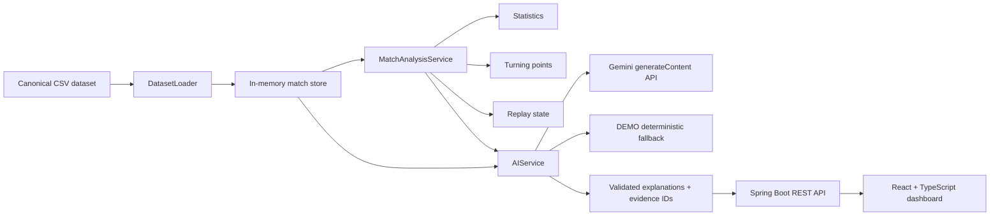

# MatchMind AI — Explainable Football Match Intelligence

MatchMind AI turns synthetic football event logs into explainable match intelligence: deterministic statistics, ranked turning points, evidence-backed explanations, personalized Fan/Analyst narratives, and an interactive synthetic replay.

**Tagline:** One Moment. The Evidence. The Story.

This is a Microsoft × Premier League Inside the Game hackathon project using fictional, football-realistic data. It is not a live Premier League feed and is not affiliated with the Premier League.

The current live provider is Google Gemini, not Microsoft Foundry. Do not claim eligibility for the hackathon's Best Use of Microsoft Foundry category unless a genuine Foundry integration is added and verified.

## What is implemented

MatchMind follows a five-stage pipeline:

1. **Ingest** — Loads the bundled CSV dataset and validates event references, chronology, score snapshots, own goals, and disallowed goals.
2. **Interpret** — Calculates supported event statistics, score progression, period comparisons, and deterministic turning-point candidates.
3. **Explain** — Uses Gemini with backend function tools when configured; DEMO mode provides deterministic evidence-based fallback answers.
4. **Render** — Displays match dashboards, timelines, turning points, evidence, recaps, replay state, and overlays in React.
5. **Personalize** — Supports Fan and Analyst modes plus a favorite team/player lens for Q&A.

## Distinctive feature: Evidence-to-Overlay

The dashboard includes a minimal broadcast-style synthetic replay. When the replay advances through a meaningful event, the backend:

- updates the simulated match state;
- reconstructs the score from valid event snapshots;
- recalculates turning-point candidates;
- returns resolved evidence event IDs; and
- renders a replay overlay with the event, score, minute, insight type, and evidence.

Controls include Play, Pause, Step, Reset, simulated minute, chronological event progression, and a visible `SYNTHETIC REPLAY` label.

## Dataset

The canonical dataset is stored in `dataset/` and is not replaced by historical or external football data.

- 12 fictional matches
- 1,262 event records
- 10 fictional teams
- 180 fictional players
- 22 independent validation checks reported as passed in `dataset/validation_report.json`

The dataset intentionally does not contain possession, pass accuracy, xG, player ratings, tracking coordinates, or complete passing networks. The application does not display those unsupported measurements.

Important scoring semantics:

- Valid scoring events are `GOAL`, `OWN_GOAL`, and `PENALTY_SCORED` when `is_goal=true` and `is_disallowed=false`.
- Disallowed goals never change the score.
- For own goals, `team_id` is the culprit’s team and `credited_team_id` is the team receiving the goal.
- Event chronology and score snapshots come from `events.csv`.

## Architecture



Uploaded matches are held in memory and remain isolated from the bundled canonical dataset. They are available through the same match, analysis, evidence, and replay APIs for the lifetime of the backend process.

## Prerequisites

- Java 17 or newer
- Maven 3.6 or newer
- Node.js 18 or newer
- npm
- Optional: Gemini API key for live AI mode

## Quick start

From the repository root, start the backend in one terminal:

```bash
cd backend
AI_MODE=DEMO mvn spring-boot:run
```

Start the frontend in another terminal:

```bash
cd frontend
npm install
npm run dev
```

Open <http://localhost:5173>. The backend API is available at <http://localhost:8080/api>.

The default dataset path is `../dataset` relative to `backend`. To override it:

```bash
DATASET_PATH=/absolute/path/to/dataset mvn spring-boot:run
```

## AI modes

### DEMO mode — verified default

DEMO mode requires no external service. It uses deterministic backend analysis and clearly reports `DEMO` in the health response and UI.

```bash
AI_MODE=DEMO mvn spring-boot:run
```

### Gemini mode — backend-only API access

Gemini is called only from the backend. Never put the API key in React, source control, or the browser.

```bash
export AI_MODE=GEMINI
export GEMINI_API_KEY='your-replacement-key'
export GEMINI_MODEL=gemini-2.0-flash

cd backend
mvn spring-boot:run
```

For local convenience, copy `backend/.env.example` to `backend/.env`, replace the placeholder with a newly generated key, and source it before starting Maven:

```bash
cp backend/.env.example backend/.env
set -a; source backend/.env; set +a
cd backend && mvn spring-boot:run
```

The `.env` file is ignored by Git. Spring Boot does not automatically source shell `.env` files, so the `source` step is required.

The backend uses Gemini’s `generateContent` endpoint with function tools equivalent to:

- `get_match_state`
- `get_match_statistics`
- `get_turning_points`
- `get_event_evidence`
- `get_player_or_team_events`

The model is instructed to retrieve evidence before making factual claims. The backend executes the five tools, returns their authoritative results to Gemini, validates returned event IDs, and falls back to deterministic DEMO output if Gemini is unavailable, times out, or returns malformed JSON. The API reports `GEMINI_UNAVAILABLE` for that failure path; it never claims Gemini generated a fallback response.

The integration follows Gemini’s documented `generateContent` and function-calling REST APIs.

## REST API

Base URL:

```text
http://localhost:8080/api
```

### Health and matches

```text
GET  /health
GET  /matches
GET  /matches/{matchId}
GET  /matches/{matchId}/events
```

`/events` accepts optional `teamId`, `eventType`, and `period` query parameters.

### Analysis

```text
GET /matches/{matchId}/statistics
GET /matches/{matchId}/turning-points
GET /matches/{matchId}/comparison
GET /matches/{matchId}/evidence/{evidenceId}
```

Evidence IDs may be event IDs or the `TP-<eventId>` form returned by turning points.

### AI

```text
GET  /matches/{matchId}/recap?mode=FAN
GET  /matches/{matchId}/recap?mode=ANALYST
POST /matches/{matchId}/questions
```

Question request example:

```json
{
  "question": "What changed the match after half-time?",
  "mode": "ANALYST",
  "preference": "Northbridge FC"
}
```

### Synthetic replay

```text
GET /matches/{matchId}/replay?sequence=20
```

The response includes the visible event prefix, simulated minute, score, resolved turning-point insights, and `label: "SYNTHETIC REPLAY"`.

### CSV upload

```text
POST /matches/upload
Content-Type: multipart/form-data
file=<csv>
```

Uploads are limited to 10 MB and must be CSV files. A compatible upload must include event fields such as:

```text
event_id,match_id,event_sequence,minute,second,timestamp_seconds,
event_type,description,is_goal,is_disallowed,
score_home_after_event,score_away_after_event,
home_team_id,away_team_id,home_team_name,away_team_name
```

The server also accepts optional event fields such as `team_id`, `team_name`, `player_id`, `player_name`, `credited_team_id`, and `event_outcome`.

Validation rejects missing headers, empty values, invalid numeric/boolean fields, duplicate IDs, non-contiguous sequences, backwards chronology, score regressions, non-goal score changes, and contradictory valid-goal snapshots. Invalid uploads return HTTP 400 with row-level errors. Valid uploads return an imported match ID and `analysisAvailable: true`.

The bundled fixture files are event-only fixtures and do not include the required repeated team metadata columns for upload import; they remain useful as canonical dataset references.

## Frontend screens

- Match dashboard with active AI mode indicator
- Match detail score banner
- Overview statistics
- Chronological event timeline
- Ranked turning points with evidence references
- Evidence-to-Overlay synthetic replay
- Fan/Analyst AI insights and Q&A
- Favorite team/player personalization
- Validated CSV upload with imported-match link

## Technology stack

### Backend

- Java 17+ / Spring Boot 3.2
- Spring Web and Actuator
- Apache Commons CSV
- Google Gemini `generateContent` REST API
- JUnit 5 and Spring test utilities

### Frontend

- React 18
- TypeScript
- Vite
- Tailwind CSS
- React Router
- Axios
- Vitest

## Testing and verification

Backend tests:

```bash
cd backend
mvn clean test
```

Frontend build and tests:

```bash
cd frontend
npm run build
npm test -- --run
```

Manual HTTP smoke checks after starting the backend:

```bash
curl http://localhost:8080/api/health
curl http://localhost:8080/api/matches
curl http://localhost:8080/api/matches/SYN-M001/statistics
curl http://localhost:8080/api/matches/SYN-M001/turning-points
curl 'http://localhost:8080/api/matches/SYN-M001/replay?sequence=20'
```

The repository’s verified checks include recap result wording, score/statistics reconstruction, turning-point evidence references, valid/invalid upload handling, frontend replay control logic, backend compilation/tests, and frontend production build.

## Project structure

```text
backend/
  src/main/java/com/matchmind/backend/
    ai/          Gemini integration and deterministic fallback
    analysis/    Statistics, period comparison, turning points
    controller/  REST and upload endpoints
    dto/         API response contracts, replay state
    model/       Match, event, team, player models
    service/     Canonical dataset and uploaded-match storage
  src/test/      Backend tests
frontend/
  src/api/       Axios API client
  src/components React dashboard, detail, upload, replay UI
  src/types/     TypeScript API contracts
  src/*.test.ts  Frontend tests
dataset/
  matches.csv, events.csv, teams.csv, players.csv
  schema.json, validation_report.json, fixtures/
docs/
  API.md, SETUP.md, DEMO_SCRIPT.md, HACKATHON_COMPLIANCE.md
```

## Honest limitations

- Replay is simulated from the bundled event dataset, not a live match feed.
- Gemini live generation depends on a valid backend-only API key, model availability, and quota.
- No public deployment URL, GitHub publication, or demonstration video is created automatically.
- No authentication is configured for this hackathon demo.
- Unsupported statistics such as possession, xG, and player ratings are intentionally omitted.

See [docs/HACKATHON_COMPLIANCE.md](docs/HACKATHON_COMPLIANCE.md) for the evidence-backed submission status and remaining external requirements.

## License and attribution

This project was created for the Microsoft × Premier League Inside the Game hackathon. All football entities and match data in the bundled dataset are fictional and synthetic.
